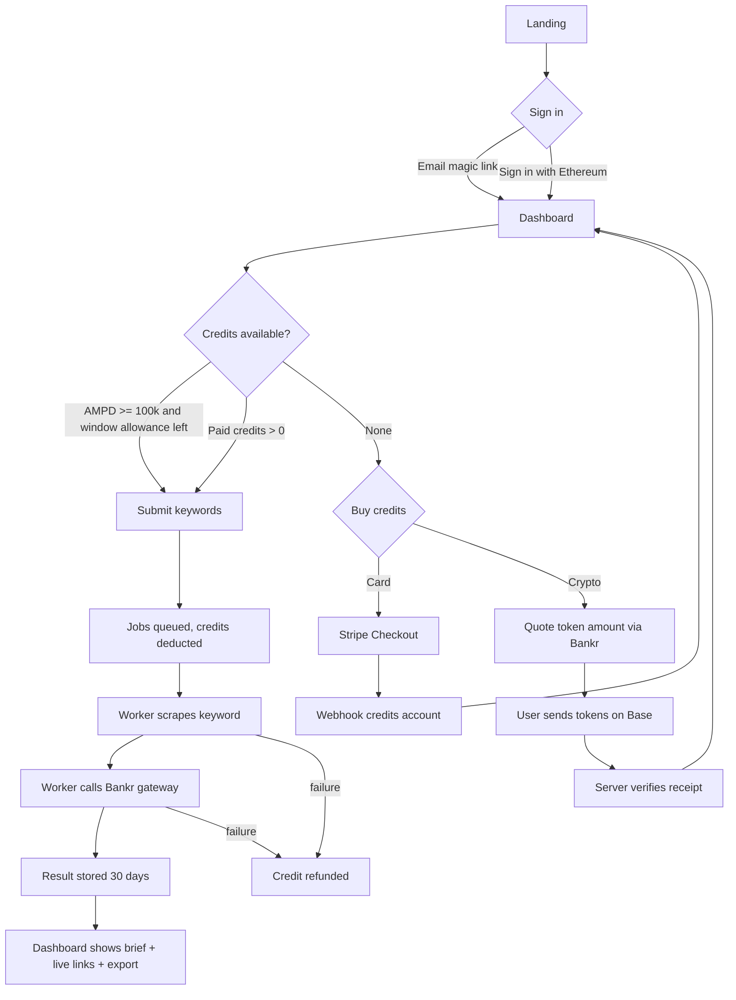

# Chatter Ample PRD — keyword research with $AMPD gating, Stripe and crypto credits, Bankr LLM gateway

**Status:** v1 draft for agent execution. Decisions below were settled with Kenny Johns on 2026-10-15.
**Repo:** `kenjohnscreates/chatter-ample` (private copy of `kenjohnscreates/chatter`, full history kept).
**Previous PRD:** [archive/PRD-ethglobal-2026-06.md](archive/PRD-ethglobal-2026-06.md) (hackathon build; Dynamic, Uniswap, ENS are all out of scope now).

This document is written for a coding agent. Every integration section ends with a **Verify before coding** list. The agent must complete those checks and record the result in [INTEGRATION_CHECKS.md](INTEGRATION_CHECKS.md) before writing code against that integration. Items marked **UNVERIFIED** could not be confirmed from the planning session (the planning environment could not reach `docs.bankr.bot`, Base RPC nodes, or Basescan).

---

## 1. Product summary

Chatter Ample is a paid keyword research tool. A user enters one or more keywords (or long-tail phrases). For each keyword the system scrapes recent conversation (Reddit, Hacker News, GitHub, Polymarket, and the other sources the `last30days` skill supports), sends the scrape to an LLM through the Bankr gateway, and returns a trend brief with live links to the posts worth paying attention to.

Access is credit based. **1 credit = 1 keyword run.**

Three ways to get credits:

| Path | Who | Mechanism |
|------|-----|-----------|
| **$AMPD holder allowance** | Wallet users holding at least 100,000 $AMPD on Base | 1 free credit per 100,000 $AMPD held, per 30-day window. Balance checked live at run time. |
| **Card** | Anyone, no wallet needed | Stripe Checkout, credit packs |
| **Crypto** | Wallet users | Send tokens on Base to the Chatter deposit wallet; backend verifies on-chain, credits the account, sweeps to USDC through the Bankr Wallet API |

Only the keyword research function from the original Chatter is kept. Swaps, asset cards, ENS receipts, the Dynamic paywall, and the PyQt desktop app are out of scope.

---

## 2. Decisions log

| # | Decision | Value |
|---|----------|-------|
| 1 | Token gate | $AMPD on Base, contract `0xf697a91e2fbf7f0f6c09c9b32d6523628ec5d3f6`, minimum 100,000 tokens, checked at run time |
| 2 | Holder allowance | `floor(balance / 100,000)` free credits per rolling 30-day window; unused free credits do not roll over; paid credits stack on top |
| 3 | Auth | Supabase Auth: email magic link, plus Sign in with Ethereum (Supabase Web3 provider). One account may link both an email and a wallet |
| 4 | Crypto payments | Base only in v1. Tokens limited to what the Bankr Wallet API can quote and swap. Deposit-and-verify flow, not a checkout contract |
| 5 | Price per credit | **Not set.** Measured cost per run comes first (task T13), then price with margin |
| 6 | Rate limit | 20 runs per rolling 24 hours per account, and per linked wallet |
| 7 | Paid credit expiry | Never |
| 8 | Hosting | Next.js on Vercel (UI, auth, Stripe webhook, crypto verification). Python worker on a DigitalOcean droplet (scrape + LLM). Supabase for Postgres, Auth, job queue |
| 9 | Scrape sources | Live `last30days` run; Kenny holds all source API keys |
| 10 | LLM step | One structured call per keyword through the Bankr LLM gateway. No Bankr Agent API in the product path |
| 11 | Model | `claude-opus-5-5` via the gateway, standard privacy tier, prepaid Bankr LLM credits |
| 12 | Retention | Results purged 30 days after completion. Per-user history visible for that window |
| 13 | Dashboard | Trend summary, momentum score, sentiment, ranked source links with titles. Export as Markdown, CSV, JSON |
| 14 | Credit accounting | Deduct on submit, refund on scrape or LLM failure |
| 15 | Bankr account | Kenny has Bankr Club; gateway key and credits to be provisioned (T0) |

---

## 3. User flow



Screens:

- **S0 Landing.** One-liner, three-step strip (sign in, add credits or hold $AMPD, run keywords), CTA.
- **S1 Sign in.** Email magic link or wallet. Wallet users see their $AMPD balance and free allowance after sign-in.
- **S2 Dashboard.** Credit balance split into "free this window" and "paid". Keyword entry (1 to 20 per submit). Run history list with status. Rate limit notice when at 20 per day.
- **S3 Buy credits.** Pack picker. Card button opens Stripe Checkout. Crypto panel: pick token, see quoted amount, send from wallet, watch confirmation.
- **S4 Run detail.** Brief, momentum, sentiment, themes, ranked links. Export buttons.
- **S5 Account.** Linked email, linked wallet, link the other, sign out.

---

## 4. Architecture

```
Browser (Next.js on Vercel)
  ├─ Supabase Auth (magic link, Sign in with Ethereum)
  ├─ /api/credits/*      entitlement, Stripe checkout, crypto quote + verify
  ├─ /api/runs/*         submit keywords, read results, export
  ├─ /api/stripe/webhook Stripe event handler
  └─ reads Supabase directly with RLS for history + results

Supabase (Postgres + Auth)
  ├─ tables: profiles, wallets, credit_ledger, runs, run_results, payments, rate_limits
  ├─ pg_cron: purge results older than 30 days, refund stuck runs
  └─ RLS: users read only their own rows; service role for server writes

Worker (DigitalOcean droplet, Docker, FastAPI + background loop)
  ├─ polls `runs` where status = queued (service role key)
  ├─ runs last30days scrape (core/research.py, Qt-free)
  ├─ calls Bankr LLM gateway (claude-opus-5-5) with strict JSON schema
  ├─ validates every link in the LLM output against the scrape input
  └─ writes run_results, marks run complete or failed (failed → refund)

External
  ├─ Stripe (Checkout Sessions + webhooks)
  ├─ Bankr LLM gateway  https://llm.bankr.bot   (Anthropic-compatible)
  ├─ Bankr Wallet API   https://api.bankr.bot    (swap-quote, swap, portfolio)
  └─ Base mainnet RPC (Alchemy): AMPD balanceOf, ERC-20 Transfer receipts
```

Why the droplet: the `last30days` scrape is a Python subprocess that runs for minutes per keyword. Vercel functions cannot host it. The droplet runs the worker only; everything user-facing stays on Vercel.

Why Supabase as the queue: one fewer service. The worker polls `runs` every 3 seconds with `FOR UPDATE SKIP LOCKED`. Expected volume (hundreds of runs per day) is far below what this handles.

---

## 5. Entitlement and credit rules

### 5.1 Credit ledger

Every credit movement is a row in `credit_ledger`. Balance is the sum. Never update a balance column in place.

| kind | sign | source |
|------|------|--------|
| `purchase_stripe` | + | Stripe webhook, keyed by `event.id` |
| `purchase_crypto` | + | verified on-chain transfer, keyed by tx hash |
| `holder_allowance` | + | computed at submit time, keyed by window id |
| `run_debit` | − | run submit |
| `run_refund` | + | run failure |
| `admin_adjust` | ± | manual |

### 5.2 Holder allowance

- `AMPD_MIN_BALANCE = 100000` (whole tokens, use contract `decimals()` for scaling).
- `AMPD_PER_CREDIT = 100000`.
- Window: 30 days starting at the user's first free-credit use. `windows` row stores `window_start`, `window_end`, `free_used`.
- At submit: read `balanceOf(wallet)` live. `allowance = floor(balance / AMPD_PER_CREDIT)`. `free_available = max(0, allowance − free_used_in_window)`. If balance is below `AMPD_MIN_BALANCE`, `free_available = 0`.
- Free credits are consumed before paid credits.
- Balance check failures (RPC down) fall back to paid credits only and show a notice. Never grant free credits on an unverified balance.
- Configurable cap `AMPD_MAX_FREE_PER_WINDOW` (default unset). See judgment calls.

### 5.3 Debit and refund

- Submit of N keywords inserts N `runs` rows and N `run_debit` rows in one transaction. If credits are short, reject the whole submit with the exact count missing.
- Worker failure (scrape error, scrape timeout at 300 s, LLM error after 2 attempts, schema validation failure) marks the run `failed` and inserts `run_refund`.
- pg_cron every 10 minutes: any run `processing` for more than 20 minutes is marked `failed` and refunded.

### 5.4 Rate limit

- 20 runs per rolling 24 hours per account. Counted on `runs.created_at` regardless of outcome.
- Same cap per wallet address, so a wallet linked to two accounts cannot double up.
- Enforced server-side in the submit route. UI shows remaining count.

---

## 6. Data model (Supabase)

```sql
-- profiles: one per auth user
create table profiles (
  id uuid primary key references auth.users(id) on delete cascade,
  email text,
  created_at timestamptz default now()
);

-- wallets: linked EVM addresses (lowercase)
create table wallets (
  address text primary key,
  user_id uuid not null references profiles(id) on delete cascade,
  chain_id int not null default 8453,
  linked_at timestamptz default now()
);

create table credit_ledger (
  id bigserial primary key,
  user_id uuid not null references profiles(id) on delete cascade,
  kind text not null check (kind in ('purchase_stripe','purchase_crypto','holder_allowance','run_debit','run_refund','admin_adjust')),
  amount int not null,                 -- positive or negative credits
  ref text,                            -- stripe event id, tx hash, run id, window id
  created_at timestamptz default now(),
  unique (kind, ref)                   -- idempotency
);

create table holder_windows (
  id bigserial primary key,
  user_id uuid not null references profiles(id) on delete cascade,
  wallet text not null references wallets(address),
  window_start timestamptz not null,
  window_end timestamptz not null,
  free_used int not null default 0
);

create table runs (
  id uuid primary key default gen_random_uuid(),
  user_id uuid not null references profiles(id) on delete cascade,
  keyword text not null,
  status text not null default 'queued' check (status in ('queued','processing','complete','failed')),
  credit_source text not null check (credit_source in ('free','paid')),
  error text,
  created_at timestamptz default now(),
  started_at timestamptz,
  completed_at timestamptz,
  expires_at timestamptz               -- completed_at + 30 days
);

create table run_results (
  run_id uuid primary key references runs(id) on delete cascade,
  raw_markdown text not null,          -- scrape output
  brief jsonb not null,                -- validated LLM output (schema in section 9)
  model text not null,
  input_tokens int, output_tokens int, cost_usd numeric(10,5),
  created_at timestamptz default now()
);

create table payments (
  id uuid primary key default gen_random_uuid(),
  user_id uuid not null references profiles(id) on delete cascade,
  method text not null check (method in ('stripe','crypto')),
  status text not null default 'pending' check (status in ('pending','confirmed','failed','expired')),
  credits int not null,
  -- stripe
  stripe_session_id text unique,
  -- crypto
  token_address text, token_symbol text, token_amount numeric(78,0), usd_value numeric(12,2),
  from_address text, tx_hash text unique, quote_expires_at timestamptz,
  swept boolean default false, sweep_ref text,
  created_at timestamptz default now(), confirmed_at timestamptz
);
```

RLS: `profiles`, `wallets`, `credit_ledger`, `holder_windows`, `runs`, `run_results`, `payments` are readable by `auth.uid() = user_id` only. All writes go through server routes or the worker using the service role key. No client-side inserts.

pg_cron jobs:
- `purge_results`: hourly, delete `run_results` where `runs.expires_at < now()`, then set `runs.status` unchanged but null out nothing else (keep the run row for history and rate-limit counting).
- `refund_stuck_runs`: every 10 minutes per 5.3.
- `expire_crypto_quotes`: every 5 minutes, `payments` crypto rows `pending` past `quote_expires_at` become `expired`.

---

## 7. Integrations

### 7.1 Supabase

**Verified during planning (2026-10-15):**
- Sign in with Web3 (EIP-4361 Sign in with Ethereum) is a first-class Supabase Auth provider. Client call is `supabase.auth.signInWithWeb3({ chain: 'ethereum', statement })`. Supabase validates the message, signature, 10-minute timestamp, and redirect URL. Docs: https://supabase.com/docs/guides/auth/auth-web3
- Web3 accounts have no email. Link an email later with `supabase.auth.linkIdentity()` or `updateUser()`. Web3 sign-in needs rate limits and CAPTCHA enabled because wallet creation is free.
- Magic link is enabled by default; PKCE flow needs the email template change and an `/auth/confirm` route.
- Existing projects in org `rgaokjdjsmgddeihtgvl`: `ample-ip-dev`, `ample-giveaway`, `dapp [mainnet]` (inactive). **Create a new project `chatter-ample`** in `us-east-1`. Do not reuse an existing one.

**Verify before coding:**
- [ ] pg_cron and pg_net extensions available on the new project (`list_extensions`).
- [ ] Web3 provider toggle present in Auth Providers for the project.
- [ ] Rate limit for Web3 sign-ins set (30 per 5 min per IP default) and hCaptcha or Turnstile enabled.
- [ ] Redirect URLs include the Vercel production and preview domains.

### 7.2 Vercel

**Verified during planning:** two teams on the account: `Kenny Johns' projects` (`team_C9NweUwXSK0JCPqdweoG5xwm`, holds the old `chatter` project) and `AMPLE` (`team_reQXlL0CNPQuUXXfY5AInkKY`). **Create project `chatter-ample` under the AMPLE team**, Git-connected to `kenjohnscreates/chatter-ample`, root directory `web`.

Env vars on Vercel (section 13). Stripe webhook route must disable body parsing to verify signatures (Next.js App Router: read `request.text()` and pass the raw string to `stripe.webhooks.constructEvent`).

**Verify before coding:**
- [ ] Next.js version in `web/package.json` is 16.x; read `node_modules/next/dist/docs/` per `web/AGENTS.md` before writing route handlers. The App Router API surface differs from training data.
- [ ] Function max duration for the crypto verification route is enough for one RPC receipt lookup (10 s is plenty).

### 7.3 Stripe

**Not verified:** no Stripe tool was connected in the planning session. The build agent must have the Stripe MCP or CLI connected and confirm the account is in test mode before touching keys.

Design:
- Products: one product "Chatter credits" with one-time prices per pack. Pack sizes are a config table, default 5, 20, 50. Unit price is set after T13 (cost measurement).
- Flow: `POST /api/credits/stripe/checkout` creates a Checkout Session in `payment` mode with `client_reference_id = user_id` and `metadata.credits`. Insert a `payments` row with `status = pending`. Redirect to the session URL.
- Webhook: `POST /api/stripe/webhook` handles `checkout.session.completed` and `checkout.session.async_payment_succeeded`. Insert `credit_ledger` with `kind = purchase_stripe`, `ref = event.id`. The unique constraint makes retries safe. Mark the payment confirmed.
- Handle `checkout.session.expired` and `async_payment_failed` by marking the payment failed.
- Never trust the success redirect page for crediting. Only the webhook credits.

**Verify before coding:**
- [ ] Stripe account exists, test mode keys available, webhook signing secret issued for the Vercel URL.
- [ ] Stripe Node SDK version and the current Checkout Session API shape (confirm the `ui_mode` and `success_url` parameters have not changed).
- [ ] Stripe CLI `stripe listen` used in local dev to forward webhooks.

### 7.4 Bankr LLM gateway

**Verified from the official Bankr skill file (`github.com/BankrBot/skills/blob/main/bankr/SKILL.md`) and search coverage. `docs.bankr.bot` was unreachable from the planning environment; the build agent must read these pages directly:**
- https://docs.bankr.bot/llm-gateway/overview/
- https://docs.bankr.bot/llm-gateway/api-reference/
- https://docs.bankr.bot/getting-started/overview/

What is known:
- Base URL `https://llm.bankr.bot`. OpenAI-compatible and Anthropic-compatible.
- Auth: Bankr API key `bk_...` in `X-API-Key` header or `Authorization: Bearer`. The key needs the LLM gateway capability (`--llm` at CLI login, or enabled at bankr.bot/api-keys).
- Credits: 1 credit = 1 USD. New keys start at 0. Any call returns HTTP 402 until credits are added (`bankr llm credits add <n>` or bankr.bot/llm). Auto top-up is available at bankr.bot/llm.
- `GET /v1/models` lists live model IDs with a per-model `pricing` object in USD per million tokens, and only shows discounts the key qualifies for. Deprecated models are hidden.
- Model IDs are bare (e.g. `claude-opus-5-5`), not `bankr/...` (that prefix is OpenClaw only).
- Privacy tiers: `standard` (default), `zdr`, `private`. A request fails instead of downgrading if no provider serves the tier.

Design:
- Use the Anthropic Python SDK with `base_url="https://llm.bankr.bot"` and `api_key=BANKR_LLM_KEY`. The SDK sends the key as `x-api-key`, which Bankr accepts (header names are case-insensitive). If the Anthropic-compatible path rejects any parameter below, fall back to the OpenAI-compatible `/v1/chat/completions` path with `response_format` JSON and note it in INTEGRATION_CHECKS.md.
- Model `claude-opus-5-5`. Thinking is always on for this model; do not send `thinking: {type: "disabled"}` (it returns 400). Set `output_config: {effort: "medium"}` explicitly and tune after T13.
- Structured output through `output_config.format` with the schema in section 9. If the gateway strips `output_config`, use a system prompt JSON contract plus server-side schema validation and one retry.
- `max_tokens` 8000. Stream not required (single short output).
- Record `usage.input_tokens`, `usage.output_tokens`, and computed cost on `run_results`.

**Verify before coding:**
- [ ] `GET https://llm.bankr.bot/v1/models` with the key returns `claude-opus-5-5` and its price. Record the price.
- [ ] One Anthropic-SDK call with `output_config.format` succeeds through the gateway. If not, record which fields are rejected.
- [ ] 402 behavior reproduced with an empty-credit key so the worker's error handling is tested.
- [ ] Confirm whether the gateway returns `usage` in Anthropic shape; the cost column depends on it.

### 7.5 Bankr Wallet API (crypto payments)

**Verified from the skill file:**
- Base URL `https://api.bankr.bot`, header `X-API-Key: bk_...`.
- `GET /wallet/me` (addresses), `GET /wallet/portfolio?chains=base`, `POST /wallet/swap-quote`, `POST /wallet/swap` (send `idempotencyKey`, retry only with the same key), `POST /wallet/transfer`, `POST /wallet/sign`, `POST /wallet/submit`.
- Reads work on read-only keys; writes need `walletApiEnabled` on a read-write key.
- Default spend limits $500 per day and per transaction, changeable only by the account owner at bankr.bot → Security.
- Chains: Base, Ethereum, Polygon, Solana, Unichain, World Chain, Arbitrum, BNB Chain, Robinhood Chain, Arc. **v1 uses Base only.**
- **UNVERIFIED:** no deposit or incoming-transfer webhook was found in any Bankr material. Assume none exists. Deposit detection is done on-chain by Chatter, not by Bankr.

Design (deposit-and-verify):
1. `POST /api/credits/crypto/quote` with `{credits, token_address}`. Server computes `usd_due = credits × price`, calls Bankr `POST /wallet/swap-quote` for `token → USDC` to derive the token amount, adds a 2 percent buffer, stores a `payments` row (`pending`, `quote_expires_at = now + 15 min`), returns `{payment_id, deposit_address, token_amount, expires_at}`. `deposit_address` is the Bankr wallet's Base address from `GET /wallet/me`, cached.
2. Browser sends the ERC-20 `transfer(deposit_address, token_amount)` (or a native ETH value transfer) from the user's connected wallet with viem, then calls `POST /api/credits/crypto/verify` with `{payment_id, tx_hash}`.
3. Server fetches the receipt from Base RPC, checks: status success, `to` matches token contract (or deposit address for ETH), a `Transfer` log from the user's linked wallet to `deposit_address` with amount ≥ quoted, block confirmed (2 confirmations), tx hash not already used. On success insert `credit_ledger` `purchase_crypto` with `ref = tx_hash`, mark payment confirmed.
4. Sweep: a worker task calls Bankr `POST /wallet/swap` `token → USDC` on Base with `idempotencyKey = payment_id`, marks `swept`. USDC deposits skip the swap. Failures do not affect the user's credits; they are retried and alerted.
5. Token allowlist v1: USDC, WETH, native ETH, $AMPD, plus any Base token for which Bankr returns a swap quote. The UI lists the first four and offers a contract address field for others.

Kenny's hard rule 4 (never execute financial transactions) applies to the planning agent, not to the product. The sweep is a product function and runs unattended, so it needs the spend limit sized for expected daily volume and the key's recipient allowlist left empty or set to the Bankr wallet itself.

**Verify before coding:**
- [ ] Read https://docs.bankr.bot/wallet-api/overview/ and confirm request and response shapes for `swap-quote`, `swap`, `me`.
- [ ] Confirm whether Bankr exposes any deposit event or webhook. If yes, replace the RPC receipt check with it only if it reports from-address, token, and amount.
- [ ] Confirm `swap` output lands in the Bankr wallet itself and that USDC on Base is a valid quote target.
- [ ] Create a dedicated Bankr API key for the worker with Wallet API enabled, Agent API disabled, Token Launch disabled, IP allowlist set to the droplet IP.

### 7.6 $AMPD token gate

**UNVERIFIED:** contract `0xf697a91e2fbf7f0f6c09c9b32d6523628ec5d3f6` could not be read from the planning environment (RPC blocked). Public aggregators show AMPD trading on Uniswap V2 on Base with 1,000,000,000 total supply but do not list this address.

**Verify before coding:**
- [ ] `symbol()`, `decimals()`, `totalSupply()` on Base return AMPD, 18 (or the real value), and 1e9 × 10^decimals. Record decimals; never hardcode 18.
- [ ] Confirm the address against an official Ample source (website or Ample's own deploy record), not an aggregator.
- [ ] Use Alchemy Base mainnet for `balanceOf`. Cache balance per wallet for 60 seconds to avoid hammering RPC on repeated submits.

### 7.7 Scrape engine (`last30days`)

Existing: `core/research.py` runs the skill as a subprocess with `--emit=compact`. Demo cache outputs are 13 to 15 KB of markdown per keyword (roughly 4,000 tokens). Source API keys live in `~/.config/last30days/.env` on the worker host.

**Verify before coding:**
- [ ] List the exact source keys the current `last30days` version expects. Kenny holds them; put them on the droplet, never in the repo.
- [ ] Confirm `--emit=compact` keeps post URLs and titles in the output. The LLM link validation in section 9 depends on it. If compact drops URLs, use the full emit and accept the larger token count.
- [ ] Measure wall time per keyword on the droplet. Set `SCRAPE_TIMEOUT_S` accordingly (default 300).

### 7.8 DigitalOcean droplet (worker host)

Design:
- Docker Compose with one service `worker` built from `worker/Dockerfile` (based on the existing `api/Dockerfile`, which already clones the skill into the image).
- Caddy in front for TLS on `worker.<domain>`. Only `/health` is public. Everything else requires `X-Worker-Secret`.
- The worker does not need inbound traffic for the queue. It polls Supabase. The HTTP surface is health plus an admin endpoint to re-run a job.
- Logs to stdout, shipped with the DO log agent or `docker logs`. Alert on consecutive failures through a simple email via Supabase or a webhook.

**Verify before coding:**
- [ ] Droplet has Python 3.12+ in the image, 2 GB RAM minimum, outbound access to Reddit, HN, GitHub, Polymarket, llm.bankr.bot, api.bankr.bot, Alchemy, Supabase.
- [ ] Droplet IP is static and placed on the Bankr key IP allowlist.

---

## 8. API contracts (Next.js route handlers)

All routes require a Supabase session unless noted. Errors return `{error: string, code: string}`.

| Route | Method | Body | Returns |
|-------|--------|------|---------|
| `/api/me` | GET | — | `{user, wallet, credits: {free_available, paid, window_end}, runs_today, runs_cap}` |
| `/api/wallet/link` | POST | `{message, signature}` | links a wallet to an email account (SIWE verify server-side) |
| `/api/runs` | POST | `{keywords: string[]}` | `{runs: [{id, keyword, status}]}`. Rejects if over cap or short on credits |
| `/api/runs` | GET | `?limit&cursor` | run history |
| `/api/runs/:id` | GET | — | run + result when complete |
| `/api/runs/:id/export` | GET | `?format=md|csv|json` | file download |
| `/api/credits/stripe/checkout` | POST | `{pack_id}` | `{url}` |
| `/api/stripe/webhook` | POST | Stripe event | 200 |
| `/api/credits/crypto/quote` | POST | `{credits, token_address}` | `{payment_id, deposit_address, token_amount, token_decimals, expires_at}` |
| `/api/credits/crypto/verify` | POST | `{payment_id, tx_hash}` | `{status, credits_added}` |
| `/api/packs` | GET | — | pack list with prices (public) |

Worker endpoints (droplet, `X-Worker-Secret`):

| Route | Method | Purpose |
|-------|--------|---------|
| `/health` | GET | public liveness |
| `/admin/requeue/:run_id` | POST | reset a failed run to queued without a new debit |

---

## 9. LLM step contract

System prompt (stable, cached):

> You are a GTM research analyst. You receive raw social and news chatter about one keyword gathered in the last 30 days. Produce a brief that tells a marketer where the conversation is, what is driving it, and which specific posts to read. Only cite URLs that appear in the input. Never invent a URL. Return JSON matching the schema.

User message: `keyword`, then the scrape markdown.

Output schema (`output_config.format`, `additionalProperties: false`):

```json
{
  "keyword": "string",
  "summary": "string (3 to 5 sentences)",
  "themes": [{"name": "string", "why_it_matters": "string"}],
  "sentiment": "positive | negative | mixed | neutral",
  "momentum_score": "integer 0-100",
  "momentum_reason": "string",
  "top_links": [
    {"title": "string", "url": "string", "source": "reddit | hackernews | github | polymarket | other", "why": "string", "rank": "integer"}
  ],
  "watch_signals": ["string"]
}
```

Post-processing in the worker:
- Parse JSON. Validate with pydantic.
- Drop any `top_links` entry whose `url` is not a substring of the scrape markdown. If more than half are dropped, retry once with a reminder. If still bad, fail the run (refund).
- Clamp `momentum_score` to 0-100. Max 10 links.

Cost model (first-party Claude list prices, to be replaced by the Bankr `/v1/models` price): `claude-opus-5-5` is $4 per million input tokens and $20 per million output tokens. A 5,000-token input with 2,000 output tokens plus medium-effort thinking lands around $0.08 to $0.15 per keyword. Scrape source costs are on top. **T13 measures the real number before any price is set.**

---

## 10. Dashboard and export

Run detail shows: keyword, status, completed time, expiry countdown, summary, momentum (number plus one-word label), sentiment chip, themes list, ranked links opening in a new tab with source badge, watch signals.

Export per run and per batch (all runs selected):
- Markdown: brief with links.
- CSV: one row per link with `keyword, rank, title, url, source, why, momentum_score, sentiment`.
- JSON: the stored `brief` object.

Expired runs stay in history with status `complete` and a "results expired" label; export is disabled.

---

## 11. Security and abuse

- All credit writes server-side with the service role key. RLS blocks client writes.
- Stripe webhook signature verified on the raw body. Idempotent on event id.
- Crypto verify: tx hash unique, from-address must equal a wallet linked to the paying user, receipt re-read from RPC (never trust client-supplied amounts).
- SIWE statements include the domain and a nonce; Supabase validates. Linking a wallet to an email account requires a fresh signature.
- Rate limits: 20 runs per day per account and per wallet; Supabase Auth rate limits and CAPTCHA on Web3 sign-in.
- Secrets never in the repo. `.env.example` lists names only.
- Worker secret rotated if the droplet is rebuilt.
- Bankr key scoped: Wallet API only, IP allowlisted, spend limit sized to daily sweep volume.

---

## 12. Retention

- `runs.expires_at = completed_at + 30 days`.
- pg_cron purges `run_results` and the raw markdown at expiry. The `runs` row stays for history and rate-limit math.
- Payments and ledger rows are kept indefinitely (financial record).

---

## 13. Environment variables

Vercel (`web`):

```
NEXT_PUBLIC_SUPABASE_URL=
NEXT_PUBLIC_SUPABASE_PUBLISHABLE_KEY=
SUPABASE_SERVICE_ROLE_KEY=            # server routes only
STRIPE_SECRET_KEY=
STRIPE_WEBHOOK_SECRET=
NEXT_PUBLIC_STRIPE_PUBLISHABLE_KEY=
BANKR_API_KEY=                        # Wallet API key for quotes and deposit address
BASE_RPC_URL=                         # Alchemy Base mainnet
AMPD_CONTRACT=0xf697a91e2fbf7f0f6c09c9b32d6523628ec5d3f6
AMPD_MIN_BALANCE=100000
AMPD_PER_CREDIT=100000
AMPD_MAX_FREE_PER_WINDOW=             # optional cap
RUNS_PER_DAY=20
CRYPTO_QUOTE_BUFFER_PCT=2
CRYPTO_QUOTE_TTL_MIN=15
```

Worker (droplet):

```
SUPABASE_URL=
SUPABASE_SERVICE_ROLE_KEY=
BANKR_LLM_KEY=                        # gateway key with LLM capability
BANKR_LLM_URL=https://llm.bankr.bot
BANKR_API_KEY=                        # Wallet API key for sweeps
LLM_MODEL=claude-opus-5-5
LLM_EFFORT=medium
SCRAPE_TIMEOUT_S=300
WORKER_SECRET=
POLL_INTERVAL_S=3
```

Source keys for `last30days` live in `~/.config/last30days/.env` on the droplet.

---

## 14. Task breakdown

Model tiers as in the previous PRD: **CHEAP** boilerplate, **MID** documented API work, **FRONTIER** payment, on-chain, and anything touching credits.

### T0 — Human prep (Kenny)
- Create GitHub repo `kenjohnscreates/chatter-ample` (the planning session's GitHub app lacked repo-create permission) and push this branch's history to it.
- Create Supabase project `chatter-ample` (org `rgaokjdjsmgddeihtgvl`, us-east-1). Enable Email and Web3 providers.
- Create Vercel project `chatter-ample` under the AMPLE team, connect the repo, root `web`.
- Stripe: account in test mode, Stripe MCP or CLI connected for the build agent.
- Bankr: at bankr.bot/api-keys create (a) a gateway key with LLM enabled and credits loaded, (b) a Wallet API key with Agent API and Token Launch disabled. Note the Base deposit address from `GET /wallet/me`. Set a spend limit at bankr.bot → Security.
- Alchemy Base mainnet key.
- DigitalOcean droplet: Ubuntu, Docker, static IP, DNS `worker.<domain>`.
- Confirm the $AMPD contract address from an official Ample source.
- Give the build agent network access to `docs.bankr.bot`.

### T1 — Repo reshape — CHEAP
- **Scope:** keep `core/research.py`, `core/skill_manager.py`, `core/https_env.py`, `api/Dockerfile` (move to `worker/`). Archive (do not delete) `ui/`, `main.py`, `api/ens.py`, `api/uniswap_*.py`, `api/gemini.py`, `web/components/{Paywall,SwapButton,EnsReceipt,AssetCard,AssetDetail,DynamicLogin,PaymentReceipt}.tsx`, `web/lib/{flow,ens,uniswapSwap,mockOnChain,dynamicBrand}.ts` under `archive/2026-10-hackathon/`. Remove Dynamic packages from `web/package.json`.
- **Accept:** `npm run build` in `web` passes with no Dynamic imports. `grep -ri dynamic web/app web/lib web/components` empty.

### T2 — Supabase schema + RLS + cron — MID
- **Files:** `supabase/migrations/0001_init.sql`, `0002_rls.sql`, `0003_cron.sql`.
- **Scope:** section 6 exactly. RLS tested with a second user.
- **Accept:** `supabase db reset` locally applies clean; a user cannot read another user's runs; cron jobs listed in `cron.job`.

### T3 — Auth (magic link + SIWE) + wallet linking — MID
- **Files:** `web/lib/supabase/{client,server}.ts`, `web/app/(auth)/*`, `web/app/auth/confirm/route.ts`, `web/app/api/wallet/link/route.ts`, `web/components/SignIn.tsx`, `web/components/WalletLink.tsx`.
- **Scope:** email magic link (PKCE), `signInWithWeb3` with EIP-6963 wallet picker, link wallet to email account via server-side SIWE verification (viem `verifyMessage`), lowercase addresses in `wallets`.
- **Accept:** email user can link a wallet; wallet user can add an email; both see one account.

### T4 — Entitlement engine — FRONTIER
- **Files:** `web/lib/credits/{ledger,holder,ratelimit}.ts`, `web/app/api/me/route.ts`.
- **Scope:** section 5. `balanceOf` via viem on `BASE_RPC_URL` with 60 s cache. Window creation and free-credit math. Rate limit math.
- **Accept:** unit tests (vitest) for: below min balance, exactly 100k, 250k, window rollover, cap, RPC failure fallback, 21st run in 24 h rejected.

### T5 — Run submission + history + results API — MID
- **Files:** `web/app/api/runs/*`, `web/app/dashboard/*`, `web/components/{KeywordEntry,RunList,RunDetail}.tsx`.
- **Scope:** transactional submit with debit, queue rows, polling UI, result rendering per section 10.
- **Accept:** submitting 3 keywords with 2 credits fails atomically; with 3 credits creates 3 queued runs and ledger shows −3.

### T6 — Worker service — MID
- **Files:** `worker/{main.py,queue.py,scrape.py,llm.py,schema.py,Dockerfile}`, `worker/docker-compose.yml`, `worker/Caddyfile`.
- **Scope:** poll loop with `SKIP LOCKED`, scrape via `core/research.py`, LLM call per section 7.4 and 9, validation, write results, failure → refund. Health endpoint.
- **Accept:** a queued run completes end to end on the droplet; a keyword that makes the scrape fail ends `failed` with a refund row.

### T7 — Stripe credits — FRONTIER
- **Files:** `web/app/api/credits/stripe/checkout/route.ts`, `web/app/api/stripe/webhook/route.ts`, `web/app/credits/page.tsx`, `web/lib/stripe.ts`, `packs` config table or constant.
- **Scope:** section 7.3.
- **Accept:** Stripe CLI test event credits exactly once on replay; success page does not credit; expired session marks payment failed.

### T8 — Crypto credits (quote, verify, sweep) — FRONTIER
- **Files:** `web/app/api/credits/crypto/{quote,verify}/route.ts`, `web/lib/bankr.ts`, `web/lib/chain/verifyTransfer.ts`, `web/components/CryptoPay.tsx`, `worker/sweep.py`.
- **Scope:** section 7.5. Native ETH path and ERC-20 path. Sweep job with idempotency key.
- **Accept:** USDC payment on Base credits after 2 confirmations; replaying the same tx hash is rejected; an underpaid transfer is rejected with the shortfall; sweep marks `swept` and is idempotent on retry.

### T9 — Export — CHEAP
- **Files:** `web/app/api/runs/[id]/export/route.ts`, `web/lib/export.ts`.
- **Accept:** md, csv, json download for a complete run; 410 for an expired run.

### T10 — Landing + account pages — CHEAP
- **Files:** `web/app/page.tsx`, `web/app/account/page.tsx`.
- **Accept:** copy per section 3, no "excited", no em dashes.

### T11 — Observability + alerts — CHEAP
- **Scope:** worker structured logs, failure counter, email or webhook alert on 3 consecutive failures, Vercel runtime error review.

### T12 — Deploy — MID
- **Files:** `docs/DEPLOY.md` rewrite for Vercel + droplet + Supabase.
- **Accept:** production URL runs one real keyword end to end with a Stripe test purchase and a Base USDC test payment of $1.

### T13 — Cost measurement and pricing — MID
- **Scope:** run 20 representative keywords in production, record scrape wall time, source API spend, gateway `usage` and cost, droplet share. Produce `docs/COST_PER_RUN.md` with mean and p95 cost per run.
- **Accept:** Kenny sets the pack prices from this document. Prices then go into the `packs` config. Until T13 is done, Stripe stays in test mode and the crypto path is behind a feature flag.

### T14 — Agent-facing x402 tier (phase 2, not v1)
- Bankr x402 Cloud can expose `/runs` as a pay-per-request endpoint for agents. Out of scope until v1 ships.

---

## 15. Judgment calls and risks

1. **Deposit detection without a Bankr webhook** means Chatter verifies receipts itself. That is more code than a hosted checkout, but it keeps the credit decision on data Chatter reads from the chain, not on a third party's callback.
2. **Whale allowance.** `floor(balance / 100k)` with no cap means a 10M holder gets 100 free runs per window. The daily cap of 20 limits burst, not total. `AMPD_MAX_FREE_PER_WINDOW` exists so this can be capped without a code change.
3. **Thin token.** AMPD trades on one Uniswap V2 pool with a small market cap. Live balance checks are correct, but the gate is cheap to pass by buying and selling around a run. If that becomes a problem, add a minimum holding age (balance at block N days ago).
4. **Bankr dependency.** The LLM gateway and the sweep both depend on prepaid Bankr credits and a single vendor. The worker should fail closed (run marked failed, credit refunded) when the gateway returns 402, and alert immediately.
5. **Price before cost is unknown.** Card payments stay in test mode until T13 lands. Shipping with a guessed price risks selling below cost.
